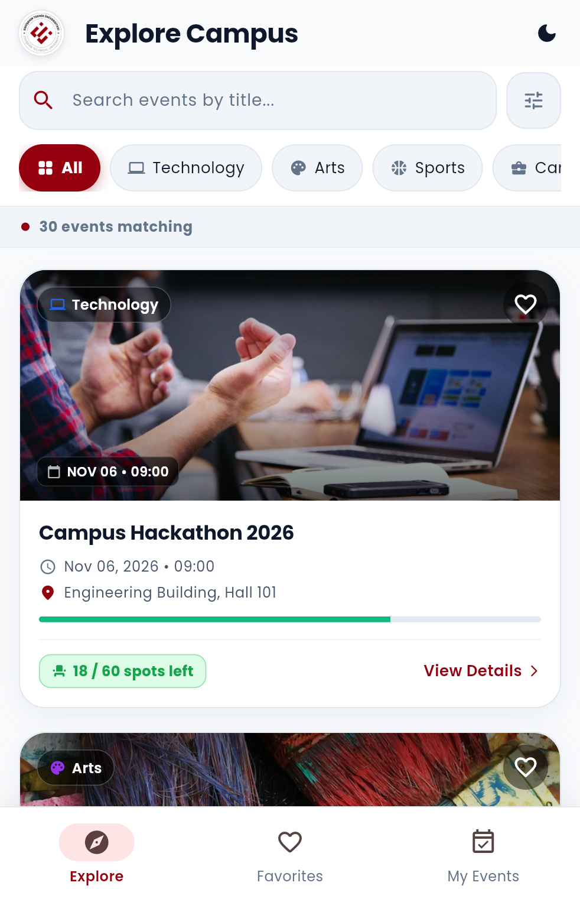
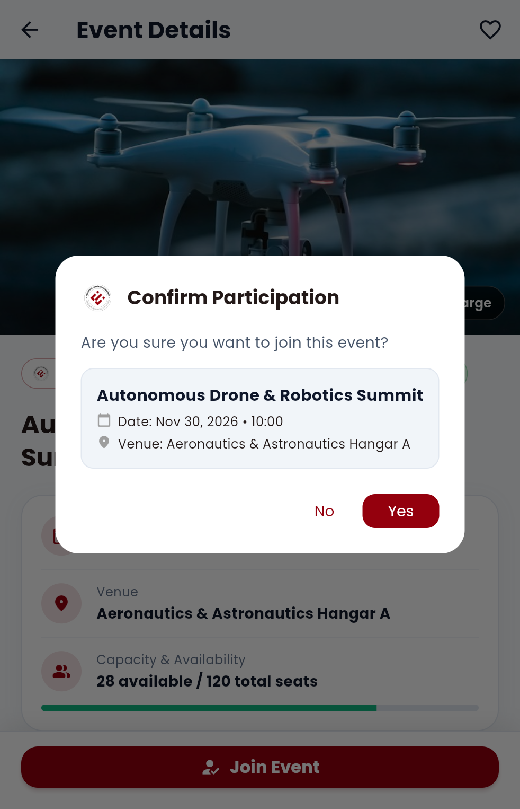
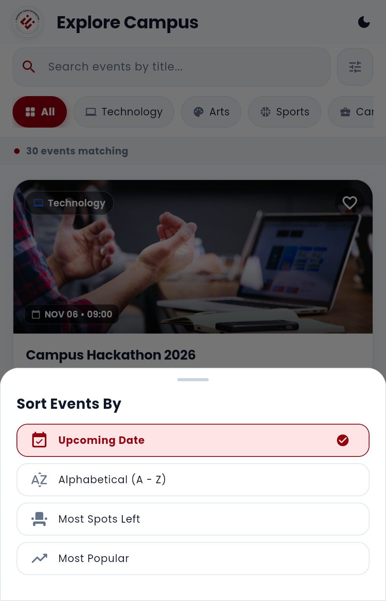

# Campus Event Explorer (BIM493 - Assignment #1)

A Flutter mobile application designed for students to explore campus events, manage favorites, and handle event registrations/participations with in-memory state management.

---

## 👥 Student Information & Team Members

| Full Name | Student ID | Contribution / Role |
| :--- | :--- | :--- |
| **Student 1 Name** | `XXXXXXXXX` | Event Model, Explore Screen, Search & Filtering, Font & Asset Integration |
| **Student 2 Name** | `XXXXXXXXX` | Event Details, Double-tap Image Viewer, Join/Cancel Dialogs & State Logic |

*(Note: Replace placeholders above with your actual names and student ID numbers before final submission.)*

---

## 🚀 Setup and Run Instructions

### Prerequisites
* Flutter SDK (Stable Channel, version 3.47.x)
* Dart SDK (3.13.x+)
* An Android emulator, connected physical Android device, or Windows desktop build environment.

### Flutter Version Output
```
Flutter 3.47.7 • channel stable • https://github.com/flutter/flutter.git
Framework • revision abaf9c5237 (5 days ago) • 2026-10-08 09:51:21 -0700
Engine • hash d8a2d6c768c334d53e16277f837970ffa1e2de81 (revision deb287481e) (6 days ago) • 2026-10-07 17:09:12.000Z
Tools • Dart 3.13.5 • DevTools 2.60.0
```

### Installation Steps
1. Clone the repository or extract the project archive:
   ```bash
   git clone <repository_url>
   cd flutter-campus-events-app
   ```
2. Get project dependencies:
   ```bash
   flutter pub get
   ```
3. Run static analysis to verify code health:
   ```bash
   flutter analyze
   ```
4. Run the automated widget tests:
   ```bash
   flutter test
   ```
5. Launch the application:
   ```bash
   flutter run
   ```

---

## 📱 Features & Implementation Details

1. **Event Data & Explore Screen:**
   - 30 realistic campus events spanning 5 categories: `Technology`, `Arts`, `Sports`, `Career`, and `Academic`.
   - Includes initially full events (`Inter-Faculty Basketball Championship`, `Game Development Bootcamp`, `E-Sports Masters`) and events with exactly one place left (`Autumn Contemporary Art Exhibition`, `Mock Coding Interviews`).
   - Scrollable event cards with local images, category badges, venue, date/time, capacity indicators, and quick favorite toggling.

2. **Combined Search, Category Filters & Event Sorting:**
   - Title search is case-insensitive and trims leading/trailing whitespace.
   - Filter chips for "All" plus 5 distinct categories (`Technology`, `Arts`, `Sports`, `Career`, `Academic`).
   - Search and category work together simultaneously.
   - **Event Sorting Options:** Interactive bottom sheet allowing sorting by Upcoming Date, Alphabetical (A-Z), Most Spots Left, and Most Popular.
   - Real-time matching count indicator (`X events matching`).
   - Clear search/reset filters buttons.
   - Applied consistently across Explore, Favorites, and My Events tabs.

3. **Event Details & Image Viewer:**
   - Detailed event view showing full description, venue, date, capacity, and current participation status.
   - **Double-tap on image:** Opens the `ImageViewerScreen` showing an enlarged view with pinch/pan zoom and normal back navigation.
   - Favorite and participation action buttons with live feedback snackbars.

4. **Favorites and My Events:**
   - **Explore Tab:** Displays all campus events.
   - **Favorites Tab:** Displays only favorited events. Shows custom empty-state if empty.
   - **My Events Tab:** Displays only registered events. Shows custom empty-state if empty.
   - Badges in bottom navigation bar reflect live counts of favorites and registered events.
   - Match counters uniformly display `X events matching`.

5. **Join & Cancel Participation Logic:**
   - **Joining:** Opens confirmation dialog specifying title, date/time, and venue. Confirming decreases available seats by 1, adds to My Events, and provides visual snackbar feedback.
   - **Cancellation:** Confirms cancellation, removes event from My Events, and restores 1 available seat.
   - **Capacity Rules:** Full events (0 seats) cannot be joined and are visibly marked as "Full". Students who registered for the last available seat retain the ability to cancel.

6. **Typography & Layout:**
   - Bundled **Poppins** custom font (Regular 400, SemiBold 600, Bold 700) declared in `pubspec.yaml` and applied globally via `ThemeData`.
   - Clean Material 3 design with ESTÜ Burgundy/Crimson corporate palette and cohesive obsidian dark mode.
   - Reusable `StatelessWidget` (`EventCard`, `EmptyStateWidget`) and `StatefulWidget` (`HomeScreen`, `EventDetailsScreen`, `ImageViewerScreen`).

---

## 🎨 Asset Credits and Licenses

### Fonts
* **Poppins Font Family**: Created by Indian Type Web (ITF) / Google Fonts.
  - License: SIL Open Font License (OFL) Version 1.1 (bundled in `assets/fonts/OFL.txt`).

### Images & Branding
* **ESTÜ Logo**: Official university emblem of Eskişehir Technical University (`assets/images/estu_logo.png`).
* **Event Photos**: All 30 event cover photos are royalty-free high-resolution photography sourced from Unsplash under the Unsplash Free License (including technology, robotics, art galleries, symphonies, sports, esports, career fairs, and astronomy).

---

## ⚠️ Known Limitations
* **In-Memory Storage Only:** As per the assignment specifications, favorited events and participations are stored in-memory during the active app session. Restarting the application resets state to the initial mock data.
* **Offline Scope:** No external backend, database, or authentication system is utilized.

---

## ✅ Verification & Test Checklist

- [x] **Full-event case:** Verified that an event with 0 available seats displays "Full", disables the join button, and prevents registrations.
- [x] **Cancel-dialog case:** Verified that cancelling participation displays a confirmation dialog, successfully restores available capacity by 1, and removes the item from My Events.
- [x] **Empty-search case:** Verified that searching for a non-matching query displays an empty-state message and provides a one-tap button to reset/clear filters.
- [x] **Double-tap image viewer:** Verified that double-tapping the image on the details screen opens the enlarged image viewer with back navigation.
- [x] **Search casing and whitespace:** Verified that queries like `"   hAcKaThOn   "` correctly match `"Campus Hackathon 2026"`.
- [x] **Static analysis & tests:** `flutter analyze` reported 0 issues, and all widget tests passed.

---

## 📷 Screenshots

The application features a responsive design supporting both ESTÜ Light Theme and Obsidian Dark Theme across all tabs and interactive states:

| 1. Explore Screen (Light Mode) | 2. Confirm Participation Dialog |
| :---: | :---: |
|  |  |
| **Explore Screen:** Event catalog featuring ESTÜ branding, category chips, capacity progress bars, and search. | **Interactive Dialog:** Confirmation modal popup before joining an event with venue and date details. |

| 3. Favorites Collection (6 Items) | 4. Event Sorting Bottom Sheet |
| :---: | :---: |
|  |  |
| **Favorites Hub:** 6 saved events with real-time bottom navigation badge counter ('6') and match indicator. | **Sorting Modal:** Bottom sheet offering sorting by Upcoming Date, Alphabetical (A-Z), and Availability. |

| 5. Live Search Query (Dark Mode) | 6. My Events — Sports (Dark Mode) |
| :---: | :---: |
|  |  |
| **Dark Mode Search:** Querying `"game"` in Obsidian Dark Mode displaying Unreal Engine Bootcamp and filter reset pill. | **Registered Hub:** Sports category filter active displaying 4 registered events with active bottom badge ('4'). |
